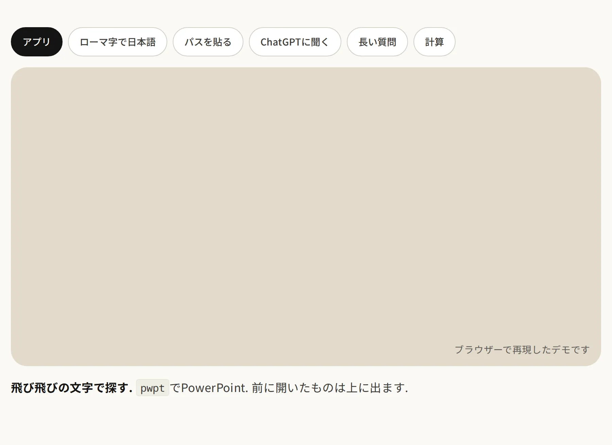

# Hikidashi(引き出し)

日本語の名前も, もらったパスも, すぐ開くWindows用ランチャー.

<a href="https://maonthemoon.github.io/hikidashi/">
  <picture>
    <source media="(max-width: 767px) and (prefers-color-scheme: dark)" srcset="docs/images/demo-narrow-dark.webp">
    <source media="(max-width: 767px)" srcset="docs/images/demo-narrow-light.webp">
    <source media="(prefers-color-scheme: dark)" srcset="docs/images/demo-dark.webp">
    
  </picture>
</a>

[ダウンロード](https://github.com/maonthemoon/hikidashi/releases/latest) | [紹介のページ](https://maonthemoon.github.io/hikidashi/)(6つの場面を選んで見られます) | [マニュアル](https://maonthemoon.github.io/hikidashi/manual.html)

ホットキーで入力欄を出し, 名前の一部を打って`Enter`で開きます. `kaigi`と打てば, 「会議」の付くファイルが出ます. 日本語入力に切り替えたり, 変換したりは要りません.

## 強み

名前を打って開くのは, どのランチャーも同じです. Hikidashiは, 日本語の仕事で挟まる変換, 貼り直し, 探し直しを減らします.

- **変換しないで, 日本語の名前を探す**: ローマ字を辞書で漢字とかなに広げて探します(`kaigi`→会議, `pawa-`→パワー). 窓を出すと日本語入力はオフになります.
- **もらったパスを, 貼ってそのまま開く**: 引用符付きでも, `/mnt/c/...`でも, `%APPDATA%\...`でも開きます. BoxのファイルのURLは, 手元のファイルとして開きます.
- **見つからなければ, そのままChatGPTへ**: いつものブラウザーのChatGPTに送るので, APIキーも追加の契約も要りません. 長い質問は, 見出しや箇条書きを整えて見ながら書けます.
- **BoxもWSLも, 同じ入力欄で**: `bx `でBox Drive, `w `でWSLのホームを探します. ふだんの一覧には混ざりません.
- **電卓を開かず, RFまで**: `=`と空白で計算のモードに入り, 16進数と2進数, dBm, VSWR, 共振, MIPI RFFEを計算します.

アプリ, ChromeとEdgeのブックマーク, Windowsの設定, クリップボードの履歴, プロセスの終了も同じ入力欄です. PowerShellなどのスクリプトと, JavaScriptの拡張も足せます.

試すのも簡単です. 約6MBのexe 1つで動き, インストールも, 管理者権限も, アカウントも要りません.

## 向いている人, 向いていない人

| 向いている | 向いていない |
|---|---|
| 日本語の名前のファイルを, 1日に何度も開く | 拡張を店から探して, 機能を増やしたい |
| メールやチャットで, パスやBoxのURLをよく受け取る | ファイルの中身まで探したい(名前だけを探します) |
| 調べものの多くを, ブラウザーのChatGPTで済ませる | 窓の整列, 定型文, 通貨の換算もまとめたい |
| WindowsとWSLを行き来する, 16進数やdBmをよく使う | AIの答えを, ランチャーの窓の中で読みたい |

拡張をたくさん使うならRaycastやFlow Launcher, Windowsの道具をまとめて使うならPowerToysなどと使い分けてください. ホットキーを分ければ, 一緒に使えます.

## インストール

動作環境はWindows 10とWindows 11(64ビット)です. 追加で入れるものはありません. Chrome, Edge, VS Code, WezTerm, Windows Terminal, WSL, Box Driveは, あれば使います.

1. [Releases](https://github.com/maonthemoon/hikidashi/releases/latest)から`Hikidashi-x.y.z.zip`をダウンロードし, 好きな場所(例: `ドキュメント\Hikidashi`)に展開します.
2. `Hikidashi.exe`を起動します. 署名していないので, 「WindowsによってPCが保護されました」と出たら「詳細情報」→「実行」を押します.
3. ホットキーを聞かれたら, 使うキー(例: `Alt+Space`)を押します. Hikidashiはタスクトレイに常駐します.

Windowsと一緒に起動するかは, 初めて起動したときに聞かれます. あとからでも, トレイのメニューで切り替えられます.

ZIPの`docs`(マニュアル), `data`(ローマ字で探すための辞書), `licenses`は, `Hikidashi.exe`と一緒に置いてください. スマート アプリ コントロールがオンのPCでは起動できません([マニュアル](https://maonthemoon.github.io/hikidashi/manual.html#smart-app-control)).

### gitを使う場合

cloneして, `bin\Hikidashi.exe`を起動します(最新のリリースと同じexeで, 隣に辞書もあります).

```sh
git clone https://github.com/maonthemoon/hikidashi.git
```

### 更新

トレイのメニューの`Quit`で終了し, 新しいZIPで置き換えて(gitなら`git pull`して), もう一度起動します. 動いている間はexeを上書きできません. 設定と学習は残ります.

### アンインストール

トレイのメニューの`Start with Windows`を外して`Quit`し, 展開した(またはcloneした)フォルダーと, `%APPDATA%\Hikidashi`, `%LOCALAPPDATA%\Hikidashi`を消します.

## 使い方

1. ホットキーを押します.
2. 名前の一部を打ちます. 飛び飛びの文字(`pwpt`→PowerPoint)でも, ローマ字でも, 貼ったパスでもかまいません.
3. `Enter`で1行目を開きます. ほかの行は`↑` `↓`で選びます.

よく使う操作です. すべての操作は[マニュアル](https://maonthemoon.github.io/hikidashi/manual.html#keys)にあります(トレイの`Manual`でも開けます).

| キー | 動き |
|---|---|
| `Enter` | 選んだ行を開く. 一致がなければChatGPTに聞く |
| `Ctrl+Enter` / `Ctrl+Alt+Enter` | 打った文字をChatGPTに聞く / Googleで検索する |
| `Shift+Enter` | 長い質問を書く窓にする(続けて`Enter`で送る) |
| `Alt+Enter` | そのフォルダーにターミナルで入る |
| `Ctrl+Shift+Enter` | 管理者として実行する |
| `Tab` | 選んだ行を入力欄に入れて, 続きを打つ |
| `→`(入力欄の終わりで) | 操作を選ぶ(フォルダーを開く, パスをコピーなど) |
| `Esc` | 隠す |

先頭に次の文字と空白を打つと, その種類だけになります.

| 先頭 | 種類 | 先頭 | 種類 |
|---|---|---|---|
| `a ` | アプリ | `bx ` | Box Drive |
| `f ` | ファイルとフォルダー | `g ` | Googleで検索する |
| `b ` | ブックマーク | `c ` | ChatGPTへの長い質問 |
| `k ` | プロセス(`Enter`で確認なしに終わらせる) | `cb ` | クリップボードの履歴 |
| `w ` | WSLのホーム | `= ` | 計算 |

ファイルは, `*.pdf`, `ext:docx,xlsx`, `in:案件`, `modified:7d`でも絞れます. キーと先頭の文字は, トレイの`Settings`で変えられます.

### 保存されるもの

| 場所 | 中身 |
|---|---|
| `%APPDATA%\Hikidashi\config.toml` | 設定. 設定画面で変える(メモ帳でも直せる) |
| `%APPDATA%\Hikidashi\learn.tsv`, `history.txt`, `compose.json` | 学習, 入力の履歴, 長い質問の書きかけと送った文 |
| `%APPDATA%\Hikidashi\state.txt`, `apps.txt`, `hikidashi.log` | ホットキー, アプリの一覧, 件数と時間とエラーの記録 |
| `%LOCALAPPDATA%\Hikidashi` | 同梱の拡張の写しと, 取ってきた辞書(exeの隣に辞書がないときだけ) |

どれもこのPCに残すだけで, どこにも送りません. Hikidashiが自分から通信するのは, 辞書が見つからず, [取ってくる](https://maonthemoon.github.io/hikidashi/manual.html#faq-romaji)ときだけです.

## 困ったとき

[よくある質問](https://maonthemoon.github.io/hikidashi/manual.html#faq)を見てください. 不具合や要望は[Issues](https://github.com/maonthemoon/hikidashi/issues)で知らせてください. `hikidashi.log`を添えるときは, フォルダーの場所やユーザー名が入っていないか, 先に中身を確かめてください.

## 開発者向け

プルリクエストを送る前に, [Issues](https://github.com/maonthemoon/hikidashi/issues)で相談してください.

### ビルド

Rust + Win32です. Linux(x86_64, aarch64)から`x86_64-pc-windows-gnu`向けにクロスコンパイルします.

1. Rustのターゲット`x86_64-pc-windows-gnu`と, mingw-w64(`gcc-mingw-w64-x86-64`)を入れます.
2. 次を実行します. テストのあと, `out/Hikidashi.exe`ができます(`bin/Hikidashi.exe`はリリースした版なので上書きしません).

```sh
./tools/build-exe.sh
```

`v`で始まるタグをpushすると, [GitHub Actions](.github/workflows/build.yml)がテストとビルドを行ってZIPをReleasesに置き, `bin/Hikidashi.exe`も差し替えます(手で更新しません). 版は[`Cargo.toml`](Cargo.toml)で決めます.

### テスト

[`crates/core`](crates/core)(検索, 並び順, 計算, 設定の読み書き)はWindowsに依存しないので, Linuxで確かめられます. [`crates/app`](crates/app)は画面とOSの部分です.

```sh
cargo test
```

### そのほかの作り直し

- 辞書: [`tools/update-dict.sh`](tools/update-dict.sh)で, [skk-dev/dict](https://github.com/skk-dev/dict)から`bin/`に取ってきます. GPLなのでexeには入れず, 別のファイルとして配ります.
- ライセンス表記: 依存を変えたら, `uv run tools/make-notices.py`で[`THIRD-PARTY-NOTICES.txt`](THIRD-PARTY-NOTICES.txt)を作り直します.
- アイコン: `uv run tools/make-icon.py`で[`assets/hikidashi.ico`](assets/hikidashi.ico)を作ります.
- READMEの動く画像: `uv run tools/make-demo.py`で, 紹介のページのデモを`docs/images/`に書き出します.
- `docs/`のHTMLは, 別に置いた元のファイルから[`tools/build-manual.sh`](tools/build-manual.sh)で作ります(元のファイルはこのリポジトリに入っていません).

## ライセンス

[MIT](LICENSE) © 2026 maonthemoon

exeに入るものなどの表記は[`THIRD-PARTY-NOTICES.txt`](THIRD-PARTY-NOTICES.txt)にあります. 同梱の辞書(SKK-JISYO.L)は[GPL](bin/SKK-JISYO.L-COPYING.txt)です.
